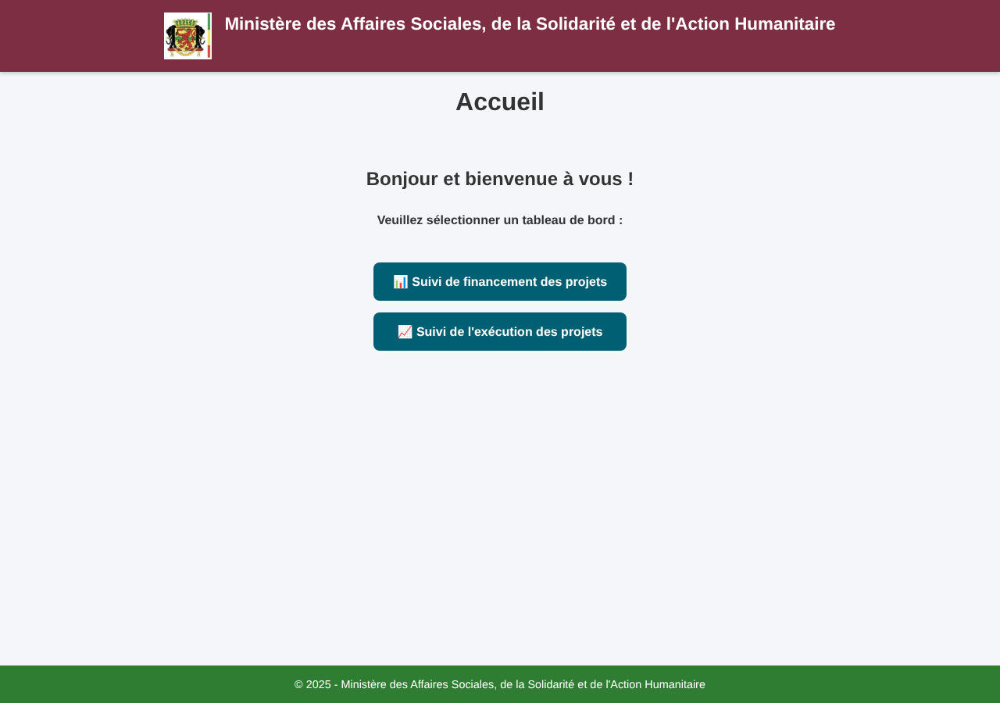
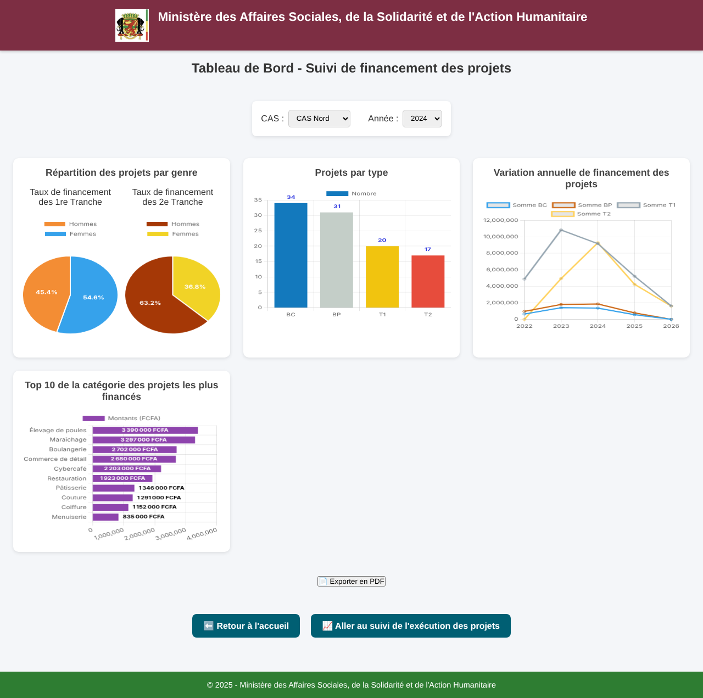
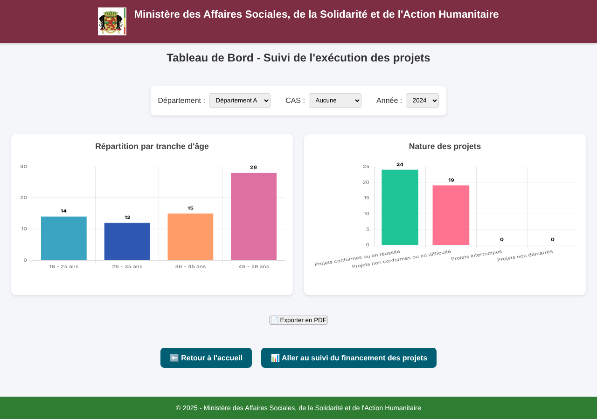

# Site MASSAH

Tableaux de bord web pour suivre le financement et l'exécution de projets de bénéficiaires, réalisés pendant mon stage à la Direction Générale des Affaires Sociales (DGAS) du Ministère des Affaires Sociales, de la Solidarité et de l'Action Humanitaire (MASSAH), à Brazzaville.

[Voir la démo en ligne](https://kazeholloway.github.io/Site-MASSAH/) · [Voir mon profil GitHub](https://github.com/KazeHolloway)

---

## Sommaire

- [Site MASSAH](#site-massah)
  - [Sommaire](#sommaire)
  - [Présentation](#présentation)
  - [Démo en ligne](#démo-en-ligne)
  - [Important : ce dépôt ne contient pas de données](#important--ce-dépôt-ne-contient-pas-de-données)
  - [Fonctionnalités](#fonctionnalités)
    - [Tableau de bord 1 : suivi du financement des projets](#tableau-de-bord-1--suivi-du-financement-des-projets)
    - [Tableau de bord 2 : suivi de l'exécution des projets](#tableau-de-bord-2--suivi-de-lexécution-des-projets)
    - [Fonctions communes](#fonctions-communes)
  - [Captures d'écran](#captures-décran)
    - [Page d'accueil](#page-daccueil)
    - [Tableau de bord 1 : financement des projets](#tableau-de-bord-1--financement-des-projets)
    - [Tableau de bord 2 : exécution des projets](#tableau-de-bord-2--exécution-des-projets)
  - [Stack technique](#stack-technique)
  - [Architecture du projet](#architecture-du-projet)
  - [Comment le site fonctionne](#comment-le-site-fonctionne)
  - [Installation](#installation)
    - [Prérequis](#prérequis)
    - [Étapes](#étapes)
  - [Utilisation](#utilisation)
  - [Contexte du projet](#contexte-du-projet)
  - [Pistes d'amélioration](#pistes-damélioration)
  - [Auteur](#auteur)
  - [Licence](#licence)

---

## Présentation

Ce site permet de consulter, sous forme de graphiques, les chiffres du suivi de petits projets financés par le ministère. Chaque bénéficiaire passe par plusieurs étapes, à savoir le bilan de compétences (BC), la définition du projet (BP), puis l'exécution du projet, payée en deux tranches (T1 et T2). Le site rassemble ces informations dans deux tableaux de bord, avec des filtres pour choisir une circonscription (CAS), un département ou une année, et un bouton pour exporter les graphiques en PDF.

Il reprend en version web un tableau de bord qui existait déjà dans Excel, pour que les responsables puissent le consulter depuis n'importe quel poste du réseau interne du ministère.

## Démo en ligne

Une version de démonstration est visible ici : [kazeholloway.github.io/Site-MASSAH](https://kazeholloway.github.io/Site-MASSAH/).

Elle est hébergée avec GitHub Pages, qui ne sait servir que des pages statiques. Il n'y a donc ni PHP ni base de données derrière : on peut parcourir les pages et voir l'allure des interfaces, mais les listes de filtres et les graphiques restent vides. Pour voir le site fonctionner avec des données, il faut l'installer en local (voir [Installation](#installation)).

## Important : ce dépôt ne contient pas de données

Le site a été conçu avec les données réelles de la DGAS. Ces données sont confidentielles (elles contiennent des informations personnelles sur des bénéficiaires), c'est pourquoi **elles ne sont pas publiées ici**.

Ce dépôt contient uniquement le code que j'ai écrit, sans base de données, sans fichier Excel et sans script d'import de données. Il est partagé **à titre de démonstration**, pour montrer les interfaces et les fonctionnalités. Les captures d'écran de ce document utilisent des données fictives, générées pour l'occasion.

Si vous souhaitez tester le site, la section [Installation](#installation) propose une structure de table et quelques lignes d'exemple inventées.

## Fonctionnalités

### Tableau de bord 1 : suivi du financement des projets

- Filtres par CAS et par année, qui mettent les graphiques à jour sans recharger la page
- Répartition par genre, avec deux camemberts (première et deuxième tranche) qui montrent la part des sommes versées aux femmes et aux hommes
- Projets par type, avec le nombre de paiements BC, BP, T1 et T2 dans l'année
- Variation annuelle du financement, avec une courbe par type de paiement
- Top 10 des natures de projets les plus financées, avec les montants en FCFA
- Export de tous les graphiques en PDF (un fichier A4 avec les filtres choisis rappelés en haut de chaque page)

### Tableau de bord 2 : suivi de l'exécution des projets

- Filtres par département, par CAS et par année (le département et le CAS ne se choisissent pas en même temps)
- Répartition des bénéficiaires par tranche d'âge (18-25, 26-35, 36-45 et 46-59 ans)
- Nature des projets, classés en projets conformes, non conformes, interrompus et non démarrés
- Export des graphiques en PDF

### Fonctions communes

- Clic sur une carte pour agrandir le graphique dans une fenêtre
- Listes de filtres remplies automatiquement à partir de la base de données
- Fonctionnement sans Internet : si le chargement de Chart.js depuis le CDN échoue, le site utilise la copie locale du dossier `libs`
- Mise en page qui s'adapte à la largeur de l'écran

## Captures d'écran

Ces images utilisent des **données fictives**.

### Page d'accueil



### Tableau de bord 1 : financement des projets



### Tableau de bord 2 : exécution des projets



## Stack technique

| Couche | Outils |
| --- | --- |
| Pages et style | HTML5, CSS3 |
| Logique côté navigateur | JavaScript (sans framework) |
| Graphiques | [Chart.js](https://www.chartjs.org/) et le plugin [chartjs-plugin-datalabels](https://chartjs-plugin-datalabels.netlify.app/) |
| Export PDF | [html2canvas](https://html2canvas.hertzen.com/) et [jsPDF](https://github.com/parallax/jsPDF) |
| Côté serveur | PHP avec PDO, qui renvoie les données au format JSON |
| Base de données | MySQL, gérée avec phpMyAdmin |
| Environnement de développement | [XAMPP](https://www.apachefriends.org/fr/index.html) (Apache, PHP, MySQL) |
| Versions | Développé et testé avec PHP 7.4 |

Les quatre bibliothèques JavaScript sont aussi fournies en copie locale dans le dossier `libs`, pour que le site puisse marcher sans connexion Internet.

## Architecture du projet

```text
Site-MASSAH/
│
├── assets/
│   └── images/
│       └── logo.png
│
├── css/
│   └── style.css
│
├── js/
│   ├── script.js          # logique du tableau de bord 1
│   └── script2.js         # logique du tableau de bord 2
│
├── libs/
│   ├── chart.min.js
│   ├── chartjs-plugin-datalabels.min.js
│   ├── html2canvas.min.js
│   └── jspdf.umd.min.js
│
├── php/
│   ├── config.php         # connexion à la base de données (PDO)
│   ├── get_filters.php    # contenu des listes déroulantes
│   └── get_data.php       # calcul des chiffres des graphiques
│
├── docs/
│   └── screenshots/       # captures d'écran (données fictives)
│
├── index.html             # page d'accueil
├── index1.html            # tableau de bord 1 : financement des projets
├── index2.html            # tableau de bord 2 : exécution des projets
└── README.md
```

La page d'accueil s'appelle `index.html` pour que GitHub Pages la trouve tout de suite.

## Comment le site fonctionne

Le site est découpé en trois parties qui se parlent, un peu comme dans un restaurant.

1. **Le navigateur** (HTML, CSS et JavaScript) affiche les pages et dessine les graphiques. C'est le client qui regarde le menu.
2. **PHP** reçoit les choix de l'utilisateur (CAS, département, année), interroge la base de données avec des requêtes préparées, puis renvoie les résultats en JSON. C'est la cuisine.
3. **MySQL** garde les données dans une table nommée `transactions`. C'est le garde-manger.

Quand l'utilisateur change un filtre, le JavaScript appelle `get_data.php`, reçoit les nouveaux chiffres et met les graphiques à jour.

## Installation

### Prérequis

- [XAMPP](https://www.apachefriends.org/fr/index.html) (ou tout autre environnement avec Apache, PHP 7.4 ou plus récent, et MySQL)
- Git

### Étapes

1. Démarrer Apache et MySQL depuis le panneau de contrôle de XAMPP.

2. Cloner le dépôt dans le dossier web de XAMPP (`htdocs`) :

   ```bash
   cd C:/xampp/htdocs
   git clone https://github.com/KazeHolloway/Site-MASSAH.git
   ```

3. Ouvrir [phpMyAdmin](http://localhost/phpmyadmin) et créer une base de données nommée `beneficiaires`.

4. Dans l'onglet SQL de cette base, créer la table `transactions`. La structure ci-dessous est un exemple fidèle aux noms de colonnes attendus par le code, et les quelques lignes ajoutées sont **entièrement inventées**.

   ```sql
   CREATE TABLE transactions (
     Numero INT PRIMARY KEY,
     Noms_Prenoms VARCHAR(150),
     Date_Naissance DATE NULL,
     Age INT NULL,
     Adresse VARCHAR(255) NULL,
     Telephone VARCHAR(30) NULL,
     CAS VARCHAR(100),
     Accompagnateur VARCHAR(150) NULL,
     Nature_Projet VARCHAR(150),
     Departement VARCHAR(100),
     Sexe VARCHAR(10),
     Handicap VARCHAR(100) NULL,
     Montant_BC DECIMAL(15,2) DEFAULT 0,
     Date_Paiement_BC DATE NULL,
     Montant_BP DECIMAL(15,2) DEFAULT 0,
     Date_Paiement_BP DATE NULL,
     Tranche1 DECIMAL(15,2) DEFAULT 0,
     Date_Tranche1 DATE NULL,
     Tranche2 DECIMAL(15,2) DEFAULT 0,
     Date_Tranche2 DATE NULL
   ) CHARACTER SET utf8mb4;

   INSERT INTO transactions
     (Numero, Noms_Prenoms, Date_Naissance, Age, CAS, Nature_Projet, Departement, Sexe,
      Montant_BC, Date_Paiement_BC, Montant_BP, Date_Paiement_BP,
      Tranche1, Date_Tranche1, Tranche2, Date_Tranche2)
   VALUES
     (1, 'Bénéficiaire 001', '1990-05-12', 35, 'CAS Nord', 'Boulangerie', 'Département A', 'F',
      40000, '2024-02-10', 60000, '2024-05-14', 450000, '2024-09-03', 380000, '2025-01-20'),
     (2, 'Bénéficiaire 002', '1985-11-02', 40, 'CAS Sud', 'Maraîchage', 'Département A', 'M',
      40000, '2024-03-01', 60000, '2024-06-11', 500000, '2024-10-15', NULL, NULL),
     (3, 'Bénéficiaire 003', '1998-07-21', 27, 'CAS Nord', 'Couture', 'Département B', 'F',
      40000, '2023-04-18', 60000, '2023-08-02', 300000, '2023-12-05', 280000, '2024-04-09');
   ```

5. Vérifier les paramètres de connexion dans `php/config.php` (par défaut avec XAMPP : hôte `127.0.0.1`, utilisateur `root`, base `beneficiaires`) et les adapter si besoin.

6. Ouvrir le site dans le navigateur : [http://localhost/Site-MASSAH/](http://localhost/Site-MASSAH/)

> Ne publiez jamais de vrais identifiants ni de vraies données personnelles dans un dépôt public.

## Utilisation

1. Sur la page d'accueil, choisir un tableau de bord.
2. Choisir les filtres en haut de la page (CAS, département, année). Les graphiques se mettent à jour tout seuls.
3. Cliquer sur une carte pour agrandir un graphique, puis sur la croix pour fermer la fenêtre.
4. Cliquer sur « Exporter en PDF » pour télécharger les graphiques avec les filtres choisis. Il vaut mieux choisir les filtres avant de cliquer.

## Contexte du projet

Ce site a été réalisé en septembre 2025, pendant un stage d'un mois à la DGAS, à la demande de la Cellule informatique. Il s'agissait de mon premier vrai site web. Il a d'abord été testé en local avec XAMPP, puis dans une machine virtuelle Windows Server, avant d'être installé sur un serveur du ministère, accessible depuis le réseau interne.

## Pistes d'amélioration

- Utiliser un compte de base de données dédié, avec seulement le droit de lire les données, à la place du compte administrateur
- Ajouter une authentification pour limiter l'accès aux personnes autorisées
- Déplacer les paramètres de connexion dans un fichier de configuration non publié
- Ajouter d'autres filtres et d'autres indicateurs
- Rendre l'affichage plus agréable sur téléphone

## Auteur

**MASSAMBA BOUESSO Christophe Darly** (alias KazeHolloway), Développeur FullStack en formation chez Akieni Academy, Brazzaville.

- GitHub : [KazeHolloway](https://github.com/KazeHolloway)
- Repository du projet : [Site-MASSAH](https://github.com/KazeHolloway/Site-MASSAH)

## Licence

Projet réalisé à des fins pédagogiques et de démonstration. Le code est partagé pour montrer mon travail, cependant les données du projet concerné ne sont pas incluses.